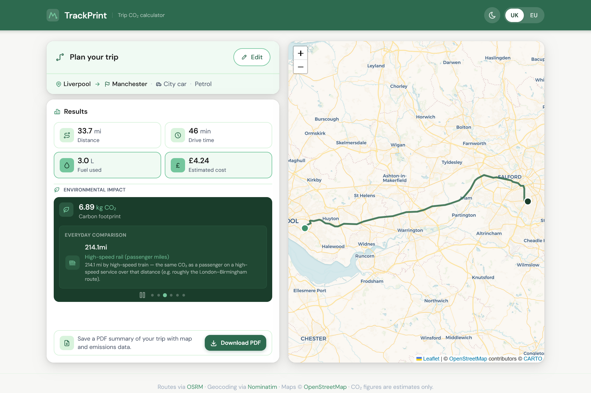

# TrackPrint

**Trip fuel-cost and CO₂ calculator with live routing.**

Enter an origin and destination, get the real road distance, estimated fuel spend, and carbon footprint — exportable as a PDF report.

🔗 **[Live demo](https://track-print-zeta.vercel.app)** *(hosted example — any static host works)*

---

## Screenshots

**Trip form** — plan a route, pick vehicle and fuel, set prices.


**Results** — distance, cost, CO₂ footprint, and route on the map (example: Liverpool → Manchester).



## What it does

- Calculates fuel cost and CO₂ emissions for a road trip based on vehicle consumption and fuel price
- Draws the real driving route on an interactive map (Leaflet + OpenStreetMap, or Google Maps)
- Supports metric and imperial units with a UK / EU market toggle (currency and units)
- Exports a trip summary as a PDF
- Fully responsive — including a draggable bottom-sheet map panel on mobile
- Dark mode

## Tech stack

| Layer | Choice |
| --- | --- |
| Framework | Vue 3 + `<script setup>` + TypeScript |
| Build | Vite, `vue-tsc` |
| State | Pinia |
| Maps | Leaflet + `@vue-leaflet/vue-leaflet` (CARTO basemap tiles), Google Maps JavaScript API |
| Routing API | OSRM (via adapter layer); optional Google Routes |
| Geocoding API | Nominatim (via adapter layer); optional Google Places |
| Styling | SCSS |
| Icons | Tabler Icons |
| PDF export | jsPDF + html2canvas |
| Tests | Vitest |
| Deploy | Static SPA (`npm run build`); optional serverless proxies under `api/` |

The codebase is fully TypeScript — components, composables, stores, services, and adapters.

## Architecture

- **Adapter pattern** — routing and geocoding providers are abstracted behind interfaces in `src/adapters/` and wired in `src/config/providers.ts`, so backends can be swapped without touching UI or business logic
- **Feature-based folders** — components and composables grouped by domain (`trip`, `map`, `layout`, `results`, `ui`)
- **Pure service layer** — fuel, emissions, and unit conversions live in `src/services/` with no Vue dependencies
- **Map driver abstraction** — Leaflet and Google Maps share a common host/shell so the results panel stays provider-agnostic
- **Tested calculations** — Vitest covers the service layer (fuel, emissions, unit conversions)

## Getting started

Try the [live demo](https://track-print-zeta.vercel.app) (hosted example) — no install required.

**Prerequisites:** [Node.js](https://nodejs.org/) 18+

```bash
git clone https://github.com/CloudXIII/TrackPrint.git
cd TrackPrint
npm install
npm run dev
```

The default stack (OSRM + Nominatim + Leaflet) needs a free **CARTO Basemaps** API key for map tiles. Routing and geocoding stay key-free.

```bash
npm run typecheck   # TypeScript check
npm run test        # unit tests (Vitest — service layer)
npm run build       # production build (type-checks first)
npm run preview     # preview production build
```

## Configuration

Copy the example env file **into `.env`** (Vite does not read `.env.example`):

```bash
cp .env.example .env
```

Edit `.env` with your provider choice and API keys. **Never commit `.env`** — only `.env.example` belongs in git.

| Variable | Required | Description |
| --- | --- | --- |
| `VITE_MAP_PROVIDER` | No | Optional unified override for **both** geocoding and routing. Valid values: `osrm` or `googleMaps`. Takes precedence over the two variables below. Do **not** use `nominatim` here — it is geocoding-only. |
| `VITE_ROUTING_PROVIDER` | No | `osrm` (default) or `googleMaps` |
| `VITE_GEOCODING_PROVIDER` | No | `nominatim` (default) or `googleMaps` |
| `VITE_CARTO_BASEMAPS_KEY` | For Leaflet / OSRM map | CARTO Basemaps API key appended as `?key=` on tile URLs |
| `VITE_GOOGLE_MAPS_KEY` | When using Google | Google Cloud API key for Routes, Places (New), Maps JS, and Static Maps |

**OpenStreetMap stack (default)**

```env
VITE_ROUTING_PROVIDER=osrm
VITE_GEOCODING_PROVIDER=nominatim
VITE_CARTO_BASEMAPS_KEY=your_carto_key_here
```

For CARTO basemap tiles:

1. Request a free key at [carto.com/basemaps/apikey](https://carto.com/basemaps/apikey/) (no CARTO account required).
2. Put it in `.env` as `VITE_CARTO_BASEMAPS_KEY`. For production, set the **same** name in your host’s environment variables and rebuild/redeploy (Vite inlines `VITE_*` at build time).
3. In the [CARTO Basemaps dashboard](https://dashboard.basemaps.carto.com/), restrict the key by **Referer host** — host only (no `https://`, path, or port), e.g. `your-app.example.com`.
4. Use a **separate** key for local dev (`localhost` / `127.0.0.1`): a restricted key cannot list both public sites and localhost.
5. Optional: preview/ephemeral deploy hosts get a new hostname often — add a matching wildcard (e.g. `*.your-project.example.com`) or another key.

Without a key, Leaflet tiles show an “API KEY REQUIRED” watermark (required since 25 September 2026). Free tier: up to 5M tile requests/month (non-commercial) or 1M (commercial). Keep OSM + CARTO attribution visible (already included). Like `VITE_GOOGLE_MAPS_KEY`, this value is embedded in the client bundle — restrict by referrer; do not treat it as a server secret.

**Google Maps stack**

```env
VITE_ROUTING_PROVIDER=googleMaps
VITE_GEOCODING_PROVIDER=googleMaps
VITE_GOOGLE_MAPS_KEY=your_api_key_here
```

For Google:

1. Create a project in [Google Cloud Console](https://console.cloud.google.com/).
2. Enable billing, then enable **Routes API**, **Places API (New)**, **Maps JavaScript API**, and **Maps Static API** — not the legacy Directions / Geocoding APIs.
3. Create an API key restricted to your domain and `http://localhost:5173/*` for local dev.

Google REST calls are proxied via `/api/google-routes` and `/api/google-places` (Vite proxy in `vite.config.ts`; production rewrites in `vercel.json` as a ready-made example for hosts that support them).

Nominatim geocoding is proxied via `/api/nominatim` — Vite in dev (`vite.config.ts`) and `api/nominatim/` in production. Browsers cannot set the `User-Agent` header that Nominatim requires; the proxy adds `TrackPrint/<version>` from `package.json`. Keep `api/` as plain JavaScript with no imports from `src/` (serverless runtimes typically cannot load the Vite app graph).

The SPA itself is host-agnostic (`npm run build` → static files). The `api/` folder and `vercel.json` are an optional production adapter for platforms with serverless functions / edge rewrites (the live demo uses one such host). Elsewhere, provide equivalent proxies for Nominatim (User-Agent) and, if you use Google, for the Routes/Places/Static paths.

When routing uses Google, the on-screen map uses **Google Maps** (Platform ToS). With OSRM, the map uses Leaflet + CARTO basemap tiles (OSM data).

## Project structure

```
api/
└── nominatim/              # Production Nominatim proxy (User-Agent) — optional hosting adapter

src/
├── adapters/               # Provider-agnostic geocoding & routing interfaces
│   ├── geocoding/
│   └── routing/
├── app/                    # App.vue, main.ts
├── assets/styles/          # Global SCSS tokens, themes, layout
├── components/
│   ├── layout/             # AppHeader, MobileBottomSheet
│   ├── map/                # RouteMap, Leaflet/Google drivers, shell
│   ├── results/            # ResultsPanel, StatTile, Co2Tile, ExportCard
│   ├── trip/               # TripForm, LocationField, FuelPills, sliders
│   └── ui/                 # ThemeToggle, MarketToggle, TablerIcon
├── composables/
│   ├── layout/             # Panel layout, mobile sheet, form collapse
│   ├── map/                # Route map host, map drivers, sheet context
│   └── trip/               # Trip state, route calculation, vehicle config
├── config/                 # Vehicles, fuels, units, providers, map views
├── constants/              # App-wide constants (layout, map, animation)
├── services/
│   ├── calculations/       # Pure fuel & CO₂ math (+ Vitest)
│   ├── googleMaps/         # Google REST client and JS API loader
│   ├── pdf/                # PDF map rendering helpers
│   └── units/              # km/mi, L/100km/MPG conversions (+ Vitest)
├── stores/                 # Pinia stores (trip + UI preferences)
├── types/                  # Shared TypeScript interfaces
└── utils/                  # Polyline decode, PDF template, location labels
```

## Notes

- CO₂ figures are estimates based on declared fuel consumption. Treat them as indicative, not precise.
- Nominatim has a [usage policy](https://operations.osmfoundation.org/policies/nominatim/) that limits request rate. This app is a demo and stays within those limits.
- Map tiles and routing data © [OpenStreetMap](https://www.openstreetmap.org/copyright) contributors.

## License

[MIT](./LICENSE) — free to use, modify, and share.
