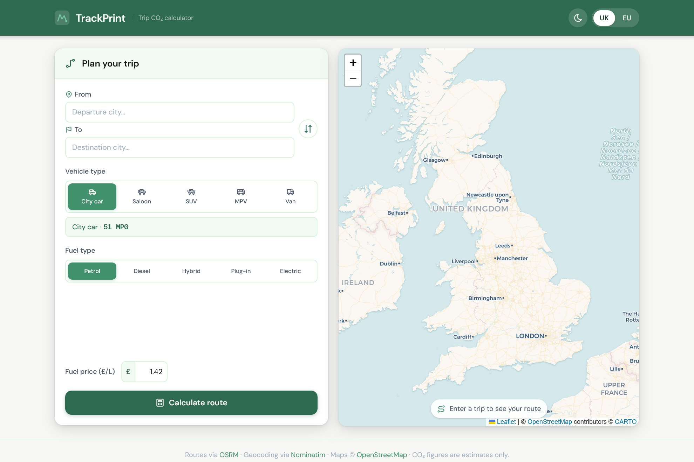

# TrackPrint

Portfolio demo app — trip fuel-cost and CO₂ calculator with interactive routing, vehicle profiles, and PDF export.

**Live demo:** [track-print-zeta.vercel.app](https://track-print-zeta.vercel.app/)

## Screenshots

**Trip form** — plan a route, pick vehicle and fuel, set prices.



**Results** — distance, cost, CO₂ footprint, and route on the map (example: Liverpool → Manchester).


## Features

- Route planning with map visualization (Leaflet + OpenStreetMap or Google Maps)
- Fuel consumption and cost estimates by vehicle type and fuel
- CO₂ emissions with rotating real-world equivalents
- OSRM / Nominatim by default; optional Google Maps providers via env vars
- UK / EU market toggle (currency and units)
- Dark mode
- Export trip summary as PDF

## Stack

| Layer | Technology |
| --- | --- |
| UI | Vue 3.5 (Composition API, `<script setup lang="ts">`), SCSS |
| Build | Vite 8, TypeScript 5, `vue-tsc` |
| State | Pinia 3 |
| Maps | Leaflet, Google Maps JavaScript API |
| Routing / geocoding | OSRM, Nominatim, Google Routes & Places |
| PDF | jsPDF, html2canvas |

The codebase is fully TypeScript — components, composables, stores, services, and adapters.

## Development approach

This project was built using **Cursor** (AI-powered IDE) as the primary development tool, going through multiple iterations of feature development and progressive refinement.

After the initial build, the codebase was manually refactored to enforce SOLID principles, improve separation of concerns (service layer, adapter pattern for external providers), and remove AI-generated boilerplate — with the goal of making the code maintainable and easy to extend by a human developer.

This reflects how I approach AI-assisted development: using AI to accelerate, then applying architectural judgment to make the result production-ready.

## Getting started

Try the [live demo](https://track-print-zeta.vercel.app/) — no install required. To run locally:

### Prerequisites

- [Node.js](https://nodejs.org/) 18+

### Install

```bash
git clone https://github.com/CloudXIII/TrackPrint.git
cd TrackPrint
npm install
```

### Configure environment

Copy the example env file **into `.env`** (Vite does not read `.env.example`):

```bash
cp .env.example .env
```

Edit `.env` with your provider choice and API keys. **Never commit `.env`** — only `.env.example` belongs in git.

| Variable | Required | Description |
| --- | --- | --- |
| `VITE_MAP_PROVIDER` | No | Optional unified override for **both** geocoding and routing. Valid values: `osrm` or `googleMaps`. Takes precedence over the two variables below. Do **not** use `nominatim` here — it is geocoding-only. |
| `VITE_ROUTING_PROVIDER` | No | `osrm` (default) or `googleMaps` |
| `VITE_GEOCODING_PROVIDER` | No | `nominatim` (default) or `googleMaps` |
| `VITE_GOOGLE_MAPS_KEY` | When using Google | Google Cloud API key for Routes, Places (New), Maps JS, and Static Maps |

**OpenStreetMap stack (default — no API key)**

```env
VITE_ROUTING_PROVIDER=osrm
VITE_GEOCODING_PROVIDER=nominatim
```

**Google Maps stack**

```env
VITE_ROUTING_PROVIDER=googleMaps
VITE_GEOCODING_PROVIDER=googleMaps
VITE_GOOGLE_MAPS_KEY=your_api_key_here
```

For Google:

1. Create a project in [Google Cloud Console](https://console.cloud.google.com/).
2. Enable billing, then enable **Routes API**, **Places API (New)**, **Maps JavaScript API**, and **Maps Static API** — not the legacy Directions / Geocoding APIs.
3. Create an API key restricted to your domain and `http://localhost:5173/*` for local dev.

Google REST calls are proxied via `/api/google-routes` and `/api/google-places` (see `vite.config.js` and `vercel.json` rewrites).

Nominatim geocoding is proxied via `/api/nominatim` — Vite in dev (`vite.config.js`) and a serverless function in production (`api/nominatim/`). Browsers cannot set the `User-Agent` header that Nominatim requires; the proxy adds `TrackPrint/<version>` from `package.json`. Keep `api/nominatim/` as plain JavaScript (do not import from `src/` — Vercel cannot run those modules).

When routing uses Google, the on-screen map uses **Google Maps** (Platform ToS). With OSRM, the map uses Leaflet + OpenStreetMap tiles.

### Run locally

```bash
npm run dev
```

Production build (type-checks first):

```bash
npm run typecheck   # optional — also runs as part of build
npm run test        # unit tests (Vitest — service layer)
npm run build
npm run preview
```

## Project structure

```
api/
└── nominatim/         # Vercel serverless proxy — User-Agent from package.json (plain JS)

docs/
├── screenshot-form.png     # README: trip form (pre-calculation)
└── screenshot-results.png  # README: results panel + map (post-calculation)

src/
├── adapters/          # Geocoding & routing adapters (DIP — swappable providers)
├── appMeta.ts         # App name, version, Nominatim User-Agent
├── assets/styles/     # Global SCSS tokens and themes
├── components/        # Vue UI components
├── composables/       # Shared Vue logic (theme, units, route calculation, PDF, …)
├── config/            # Vehicles, fuels, units, map styles, default map views
├── constants/         # App-wide constants (storage keys, conversion factors, …)
├── services/
│   ├── calculations/  # Pure fuel & CO₂ math
│   ├── googleMaps/    # Google REST client and JS API loader
│   ├── pdf/           # PDF map rendering helpers
│   └── units/         # km/mi, L/100km/MPG conversions
├── stores/            # Pinia stores (trip + UI preferences)
├── types/             # Shared TypeScript interfaces
└── utils/             # Helpers (polyline, PDF template, location labels, icons)
```

See [CONTRIBUTING.md](./CONTRIBUTING.md) for how to add vehicles, fuels, or providers.

## License

[MIT](./LICENSE) — free to use, modify, and share. CO₂ figures and cost estimates are indicative only.
